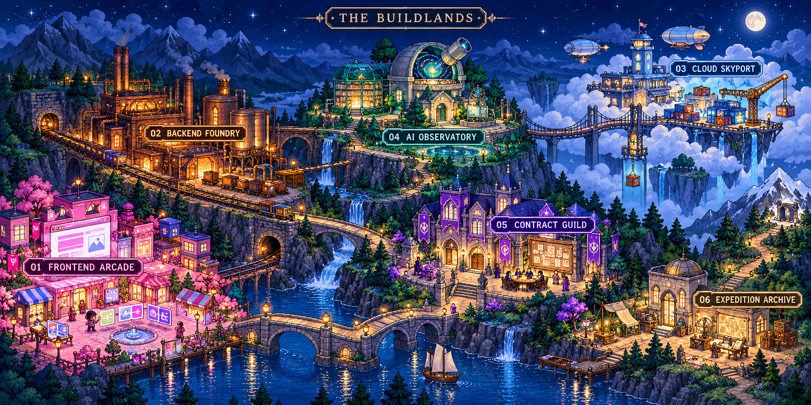

<h1 align="center">Suryadeepsinh Gohil</h1>

<strong>Full-stack engineering · Backend systems · Cloud delivery · Applied AI</strong> AI Platform Engineer on Syncrope's Data Platform Team

I build across interfaces, APIs, workflows, event streams and cloud delivery. My AI work spans retrieval, parameter-efficient fine-tuning, and separate client engagements in terminal-based LLM task authoring and evaluation. Founder-facing product work and production diagnosis connect those disciplines.

**[Portfolio](https://suryadeepsinh-gohil.vercel.app/) · [LinkedIn](https://www.linkedin.com/in/suryadeepsinh-gohil/) · [Inspect the work](#06-expedition-archive)**

## Enter The Buildlands

A software town with six connected districts. Follow a route, inspect the artifacts, or open the tool inventory.

**Choose a route**

- **Build a product:** [01 Frontend Arcade](#01-frontend-arcade) → [02 Backend Foundry](#02-backend-foundry) → [03 Cloud Skyport](#03-cloud-skyport).
- **Inspect the engineering:** [06 Expedition Archive](#06-expedition-archive) → [systems and data](#02-backend-foundry) → [model work](#04-ai-observatory).
- **Find a project partner:** [05 Contract Guild](#05-contract-guild) → [delivery practice](#03-cloud-skyport) → [connect](#return-to-base).

## 01 Frontend Arcade

**Interfaces, shared components and independent releases.** My professional frontend work includes Vue micro-frontends for billing and reporting, module federation, and a shared component library. I worked with typed Vuex state to address stale-state behavior, alongside server-side rendering, streamed HTML and critical CSS for mobile rendering.

This is the part of the system where release boundaries become visible to users: a change to reporting should not force every other interface to ship at once. My broader frontend toolkit includes React, TypeScript, JavaScript, HTML, CSS, Tailwind CSS and Bootstrap. Cypress covers user journeys alongside the service tests behind them.

**Inspect:** [design-system case study](https://suryadeepsinh-gohil.vercel.app/projects/design-system-tokens), a write-up of token-driven themes and shared React components. The case study is an architecture account; it does not provide a public application repository.

## 02 Backend Foundry

**APIs, workflow state, data movement and failure boundaries.** At Syncrope, my contributions span Node.js, NestJS and TypeScript services, MongoDB data modelling, Redis caches, and BullMQ job coordination. Workflow runs use persisted state so execution can resume after service restarts. Separately, Kafka consumer groups handle analytics, notifications and CRM synchronization, with retry topics and backoff around delivery failures.

I have also worked on patient-scheduling APIs, request validation, JWT authentication, service-layer authorization, and Stripe subscription handling. That work includes webhook-signature verification and deduplication using event identifiers. These are separate implementations with their own contracts, rather than one universal promise about exactly-once delivery.

**Data rail:** my selected project contributions include Flink windowed aggregates and interval joins, watermark-aware late arrivals, RocksDB state, incremental S3 checkpoints, and a parity harness for comparing batch and streaming outputs before cutover.

**Core tools:** Go (Golang), Python, TypeScript, Node.js, NestJS, MongoDB, Redis, BullMQ, Kafka, Avro and SQL. Django, Flask, FastAPI, Express.js and PostgreSQL are also in my backend toolkit.

**Inspect:** [stream-processing case study](https://suryadeepsinh-gohil.vercel.app/projects/stream-processing-flink) and [Stormcheck's analysis code](https://github.com/Suryadeep02/Stormcheck/blob/main/src/stormcheck/analysis.py). The first is a team-project write-up; the second is a small public tool.

## 03 Cloud Skyport

**Ship, observe, diagnose, repeat.** My professional delivery work includes multi-stage Docker builds in GitHub Actions, type-check and test gates, and blue-green Kubernetes deployments with readiness checks and rollback behavior. On AWS, the concrete service examples include EKS for backend workloads and ElastiCache for Redis, with autoscaling signals from queue depth and CPU.

For operational debugging, I have used Prometheus metrics, Grafana dashboards and Tempo traces to follow a latency regression into repeated database queries, then change the query path and add monitoring for the failure pattern. Jest, disposable database integration tests and Cypress smoke coverage connect release checks to application behavior.

I also bring on-call participation, failure-mode reviews and experience mentoring junior engineers through production service work. My infrastructure toolkit extends to Terraform, Ansible, CloudFormation and additional AWS services, listed in the inventory below.

**Inspect:** [observability case study](https://suryadeepsinh-gohil.vercel.app/projects/observability-platform-otel) for the architecture narrative, and [Stormcheck CI](https://github.com/Suryadeep02/Stormcheck/actions) for public automated checks. A green test run proves only the behavior those tests cover.

## 04 AI Observatory

**Three connected disciplines: retrieval, adaptation and evaluation.**

**Retrieval and agents.** On a small team, I contributed to LangGraph orchestration and retrieval across BM25, dense vectors and two-hop knowledge-graph expansion. Reciprocal-rank fusion combines results; critique loops use retry budgets, wall-clock limits and refusal thresholds. The [Agentic RAG case study](https://suryadeepsinh-gohil.vercel.app/projects/agentic-rag-knowledge-graph) explains the design. Its application code and evaluation set are not public here.

**Parameter-efficient fine-tuning.** My Syncrope contributions include Mistral 7B adaptation with QLoRA: a base model held frozen in 4-bit NF4 while low-rank adapters are trained. The work focuses on the trainable footprint and quantization method; a public accuracy or memory benchmark is not included here.

**Terminal tasks and evaluation.** In separate client engagements, I create terminal-based LLM training tasks, define instructions and expected outcomes, and assess model attempts for completion, difficulty and grading consistency. This includes work on task environments and quality control. Client tasks and raw evaluation artifacts remain private; task/evaluation work is distinct from owning an entire reinforcement-learning pipeline.

**Tools across this work:** Python, LangGraph, LangChain, Hugging Face, Mistral 7B, QLoRA/LoRA, NF4, BM25, vector retrieval, Neo4j and pgvector. Each belongs to a particular workflow, not a claim that every project uses the whole list.

## 05 Contract Guild

**A founder-facing engineering lane and a separate evaluation lane.** At Syncrope, I have worked with founders in a zero-to-one setting across requirements, implementation and production support. That connects product behavior with API contracts, data models, release plans and diagnosis when the system does not behave as expected.

My separate contract engagements cover terminal-task creation and model-attempt evaluation, plus quality-control review across instructions, expected outcomes and grading decisions. I keep those contributions distinct from employer work and keep client artifacts private.

**Domain trail:** documented professional examples include patient scheduling, billing and subscriptions, messaging and CRM integrations. Selected team-project contributions cover healthcare-research retrieval and orders/inventory streaming. My portfolio also contains write-ups in fintech/core banking, logistics SaaS, conversational AI, productivity, creator tools and commerce; their implementation evidence and project scope vary.

**Campaign history:** Beadaptify Innovations, 2021-2022; Syncrope, 2023-present. My Software Engineer period at Syncrope ended in September 2024, followed by promotion to AI Platform Engineer. Project examples above describe contributions across those engagements without inventing dates for individual achievements.

**Inspect:** [the portfolio's project index](https://suryadeepsinh-gohil.vercel.app/projects), or [connect on LinkedIn](https://www.linkedin.com/in/suryadeepsinh-gohil/) around a specific engineering problem.

## 06 Expedition Archive

**Pick an artifact by the kind of evidence you want.**

### ProgramBench DOT layout | Public evaluation demo

An independently authored application demo for evaluating source reconstruction of a graph-layout command. My work includes task design, fixture generation, a semantic and geometry-aware comparator, isolated grading and analysis of recorded model attempts. [Inspect the source, tests and validation notes](https://github.com/Suryadeep02/programbench-dot-layout-demo). This demonstrates task and evaluation engineering, not a full LLM training pipeline.

### Stormcheck | Public Python utility

**Problem:** inspect retry and timeout configuration in a declared service topology. **My artifact:** a CLI, local web UI, examples and tests. **Stack:** Python and YAML. **Inspect:** [source](https://github.com/Suryadeep02/Stormcheck), [tests](https://github.com/Suryadeep02/Stormcheck/tree/main/tests), [CI](https://github.com/Suryadeep02/Stormcheck/actions). **Boundary:** a static model, not a runtime traffic simulator. Input validation and modeling limits still need improvement.

### Agentic RAG | Team contribution, architecture write-up

**Problem:** retrieve evidence and keep tool execution bounded. **My contribution:** orchestration and retrieval work on a small team. **Stack:** LangGraph, lexical/vector retrieval and knowledge graphs. **Inspect:** [case study](https://suryadeepsinh-gohil.vercel.app/projects/agentic-rag-knowledge-graph). **Boundary:** the public page describes the design; runnable application code and measured evaluation artifacts are not available here.

### Streaming data | Team contribution, architecture write-up

**Problem:** move selected analytics from batch processing toward event streams. **My contribution:** Flink jobs, state/checkpoints and parity checks. **Stack:** Kafka, Flink, RocksDB and S3. **Inspect:** [case study](https://suryadeepsinh-gohil.vercel.app/projects/stream-processing-flink). **Boundary:** team-project experience rather than a downloadable public benchmark.

### Unreal Engine simulation | In development

Developing an Unreal Engine mining simulation with a planned interface for training and evaluating autonomous heavy vehicles. The environment is work in progress. The training interface is planned, and an autonomous training loop is not demonstrated. Project assets and implementation remain private.

### Incremental SQL engine | Design phase

In design: a single-node incremental SQL engine with planned crash recovery and an interactive execution console.

### Side quest: the job timed out. What now?

A design thought experiment. A payment request timed out, and its final outcome is unknown. Choose your next move.

<strong>Retry immediately</strong>

The timeout does not tell you whether the side effect happened. A blind retry can repeat an operation. First establish the outcome or use a well-defined idempotency contract at the boundary that owns the side effect.

<strong>Increase every timeout</strong>

A larger timeout can change waiting behavior but cannot establish what already happened. It may also keep resources occupied longer. Look for the failed boundary, the available deadline and the downstream outcome.

<strong>Inspect the outcome and retry boundary</strong>

Follow the operation identifier, persisted workflow state and downstream record. Decide which step is safe to repeat, bound retries and backoff, and surface unresolved outcomes for reconciliation. These are design questions, not a claim that Stormcheck implements transaction recovery.

## Inventory chest

The examples above show where particular tools were used. This broader inventory records additional technical background; it is not a set of proficiency scores or a claim of equal production depth in every tool.

<strong>Open the complete working stack and service inventory</strong>

**Languages and application development**

- Go (Golang), Python, JavaScript, TypeScript: services, interfaces, tooling and AI workflows.
- Node.js, NestJS, Express.js, Django, Flask, FastAPI: backend application frameworks.
- React, Vue.js, Vuex, module federation: interfaces, state and frontend composition.
- HTML, CSS, Tailwind CSS, Bootstrap: layout, styling and reusable interface work.
- Stripe: subscription billing and webhook integration in a professional client application.

**Storage, events and analytics**

- MongoDB, Redis, BullMQ: documented application state, caching and background-job examples.
- Kafka and Avro: event pipelines and schema-based ingestion; RabbitMQ and ActiveMQ are additional messaging background.
- PostgreSQL, MySQL, DynamoDB, Oracle SQL, Cassandra and RDS: broader database inventory.
- Flink, RocksDB, S3: documented streaming jobs and checkpointing contributions.
- Spark, Airflow, Iceberg, ClickHouse, Trino and dbt: broader data-platform inventory.
- Pandas, NumPy, Matplotlib and SQLAlchemy: analysis, transformation and database-access tooling.

**Cloud, delivery and operations**

- AWS EKS and ElastiCache: concrete workload-scaling and Redis service examples above.
- AWS Lambda, API Gateway, EC2, RDS, CloudWatch, S3, DynamoDB and Elastic Beanstalk: additional AWS service background. Azure is also in my cloud inventory.
- Docker, Kubernetes, Git and GitHub Actions: documented build, deployment and verification work.
- Terraform, Ansible, CloudFormation, Jenkins, CircleCI and TravisCI: additional infrastructure and delivery tooling.
- Prometheus, Grafana and Tempo: documented diagnosis through metrics, dashboards and traces.
- ELK Stack, Datadog and New Relic: broader observability background.

**AI, testing and quality**

- LangGraph, LangChain, RAG, BM25, Neo4j and pgvector: retrieval and orchestration.
- Mistral 7B, QLoRA, LoRA and NF4: the fine-tuning contribution described above. Llama 3 and Hugging Face are also in my model tooling background.
- Jest and Cypress: documented integration, merge-gate and user-flow testing. Pytest is used in the public Stormcheck tests.
- Selenium, Mocha, JUnit, Postman and LoadRunner: broader testing and API/performance tooling.
- OWASP ZAP and Bandit: security-checking tools in my technical background. Authentication and authorization examples above describe the actual application mechanisms.

**Additional technologies in project write-ups**

My portfolio discusses Go, Rust/WebAssembly, Three.js/WebGL/GLTF, Style Dictionary/Storybook, GraphQL, OpenTelemetry, Cloudflare, Helm, policy and secrets tooling, and federated-learning prototypes. These are project-specific narratives, not independently reproduced public implementations or proof of equal expertise across the list.

## Return to base

If your team needs someone who can follow a feature from interface to API, data flow, deployment and production diagnosis, that is the work I want to discuss. AI platform and evaluation work are a particular interest; backend, full-stack and general platform roles are welcome too.

**[Explore the portfolio](https://suryadeepsinh-gohil.vercel.app/) · [Connect on LinkedIn](https://www.linkedin.com/in/suryadeepsinh-gohil/)**
